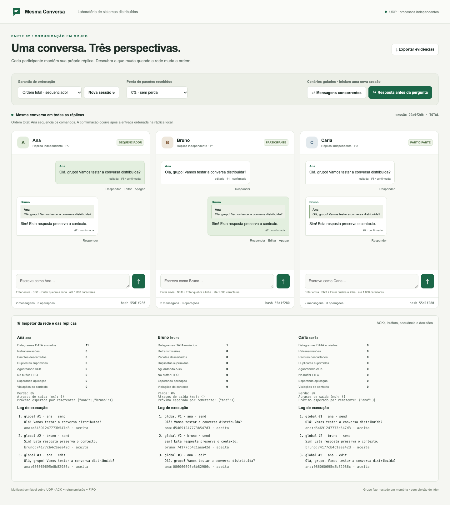
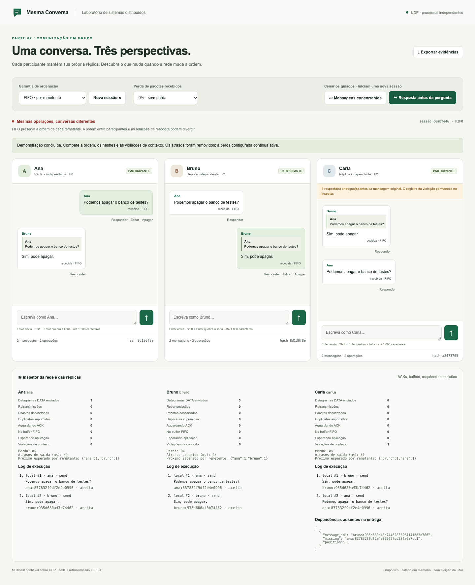

# Parte 2 — Mesma Conversa

Chat de grupo replicado para demonstrar que **receber todas as mensagens em FIFO não implica ver a mesma conversa**. Cada participante é um processo Python independente, mantém sua própria réplica em memória e troca comandos de aplicação com os outros processos por UDP.





## Executar

Python **3.10 ou superior** e um navegador moderno. Esta parte usa somente a biblioteca padrão: não precisa de `pip install`, Node, serviço externo nem IP público.

Na raiz do repositório:

```bash
python3 -m group_chat
```

Abra **http://127.0.0.1:8080**. O comando inicia os processos de Ana, Bruno e Carla e o painel. `Ctrl+C` encerra o painel e seus processos filhos. A conversa começa vazia, sem mensagens fictícias.

```bash
# Começar com a garantia da parte 1 e 30% de perda
python3 -m group_chat run --mode fifo --loss 0.3

# Usar outras portas, por exemplo para executar duas instâncias simultâneas
python3 -m group_chat run --port 8081 --udp-base 9300 --peer-base 9400
```

Portas padrão: painel HTTP `8080`, peers UDP `9100–9102`, peers HTTP `9200–9202`. Se uma porta estiver ocupada, a inicialização informa o erro e encerra os filhos que criou. Endereços locais são explícitos; vários peers podem rodar na mesma máquina.

## Usar o chat

- Cada coluna mostra **o estado da própria réplica**. Digite na coluna de Ana para enviar como Ana, e assim por diante.
- `Enter` envia; `Shift+Enter` insere uma quebra de linha. Limite: 1.000 caracteres.
- O envio fica pendente até ser aplicado localmente. No modo total, recebe também uma posição global. Confirmação local não significa que todos os peers já aplicaram a mensagem.
- **Responder** referencia o ID de uma mensagem já confirmada na réplica do remetente.
- **Editar** e **Apagar** são comandos distribuídos. Apenas o autor pode alterar sua mensagem. Uma exclusão mantém o ID e um marcador, preservando as referências das respostas. Uma mensagem apagada não pode ser editada.
- O seletor de perda se aplica imediatamente aos peers. Ele afeta a recepção de DATA e ACK, inclusive tráfego para o próprio peer.
- Para trocar o protocolo, selecione a garantia e clique em **Nova sessão**. Essa ação limpa o histórico, reinicia os processos e muda o identificador da sessão. Mudar somente o seletor não troca o protocolo em execução; o modo ativo aparece junto à sessão.
- Os cenários guiados também iniciam uma sessão vazia, usando **o modo ativo** e a perda configurada. Durante o cenário, o painel bloqueia envios manuais.
- **Inspetor** mostra retransmissões, duplicatas, ACKs pendentes, buffers, posições de execução e decisões aceitas/rejeitadas.
- **Exportar evidências** baixa o estado, os logs e as métricas das réplicas em JSON. Para um registro final, espere o sistema sair de “Mensagens em trânsito”.

## Roteiro da apresentação

### 1. Mesmas mensagens, ordens diferentes

1. Escolha **FIFO**, clique em **Nova sessão** e deixe a perda em 0%.
2. Execute **Mensagens concorrentes**. O cenário atrasa Ana → Bruno e Bruno → Ana em 1,2 s.
3. Ana entrega primeiro a própria sugestão; Bruno entrega primeiro a dele. Todos recebem as duas mensagens, mas os logs e os hashes divergem.
4. Escolha **Ordem total**, inicie uma nova sessão e repita o cenário.
5. As rotas ainda têm atrasos, mas todas as réplicas executam os comandos na mesma ordem global.

### 2. Uma resposta chega antes da pergunta

1. Em **FIFO**, execute **Resposta antes da pergunta**, com perda em 0%.
2. Ana envia “Podemos apagar o banco de testes?”. O caminho de Ana até Carla tem atraso de 1,8 s.
3. Assim que Bruno aplica a pergunta, ele envia “Sim, pode apagar.” com referência à mensagem de Ana.
4. Carla recebe primeiro a resposta e mostra a dependência ausente. Quando a pergunta chega, a citação se resolve, mas o registro da violação causal permanece.
5. Repita em **Ordem total**. Os comandos de conversa vêm de um único sequenciador; a pergunta é entregue antes da resposta em todas as réplicas.

Em FIFO, a mensagem de Ana e a de Bruno pertencem a fluxos diferentes. Preservar cada fluxo não preserva a relação entre eles. Em ordem total, o contexto também é preservado **pelas regras da aplicação**: só se pode responder a uma mensagem já aplicada, portanto já sequenciada. Ordem total isoladamente não implica causalidade em todo protocolo possível.

### 3. Perda de pacotes

1. Use **Ordem total**, configure 30% de perda e execute um cenário ou converse manualmente.
2. Acompanhe as retransmissões e ACKs no inspetor. O protocolo também confirma novamente DATA duplicados, recuperando ACKs perdidos.
3. Espere as réplicas ficarem ociosas. Os hashes e a sequência completa de comandos devem coincidir, sem mensagens duplicadas.

Os atrasos artificiais valem para cada novo DATA na rota configurada; retransmissões só começam após sua primeira liberação. Eles não são uma pausa na interface. Ao concluir um cenário com sucesso, os atrasos são removidos; a perda continua ativa. Com perda aleatória, o tempo de conclusão varia e a ordem relativa dos pedidos concorrentes pode mudar; o modo total continua exigindo acordo, sem prometer que um determinado autor será sempre o primeiro. Para reproduzir exatamente as divergências FIFO dos roteiros, use 0% de perda.

## Arquitetura

```text
                       Navegador
                 comandos / snapshots HTTP
                           │
                 Painel e lançador local
              /api/state, /api/peers/.../command
                     /      │      \
                  HTTP     HTTP     HTTP
                   │        │        │
               Peer Ana  Peer Bruno  Peer Carla
               réplica A réplica B   réplica C
                   ╲        │        ╱
                  UDP confiável entre peers
                 ACK + retransmissão + FIFO
```

O painel apenas encaminha pedidos, consulta estados e conduz os cenários. **Não replica o histórico nem decide a ordem das mensagens.** As decisões e as conversas são mantidas nos processos dos peers. Cada processo tem um servidor HTTP de controle, uma thread de transporte UDP e uma thread de aplicação. A fila de entrega separa rede e regras de negócio.

| Arquivo | Responsabilidade |
| --- | --- |
| `transport.py` | UDP, ACK, retransmissão, FIFO, perda e atraso simulados |
| `model.py` | Conversa determinística, respostas, edição, exclusão, decisões e hash |
| `node.py` | Integração da aplicação com FIFO ou sequenciador |
| `http_api.py` | Fronteira HTTP/JSON dos peers |
| `dashboard.py` | Processos, comparação de réplicas, exportação e cenários |
| `config.py` | Grupo fixo, endereços, portas e sessão |
| `static/` | Interface sem dependências ou CDN |
| `tests/` | Regras de negócio e integrações com sockets e processos reais |

### Multicast confiável e FIFO

É um **multicast de aplicação**: o envio ao grupo é implementado com um datagrama UDP unicast por destino, incluindo o remetente. Não usa multicast IP. Mantém o princípio da parte 1, com ACK por destino, retransmissão por timeout e buffer de mensagens adiantadas.

O fluxo FIFO é identificado por **sessão + remetente + destino**. Cada destinatário tem sua própria sequência, permitindo combinar propostas unicast com comandos multicast sem criar lacunas nas sequências dos outros destinos. DATA transporta `epoch`, `sender`, `destination`, `seq` e `payload`; ACK identifica a mesma sequência no fluxo de volta. Pacotes de outra sessão são descartados.

O receptor confirma inclusive duplicatas. Mensagens adiantadas são confirmadas ao entrar no buffer, mas só chegam à aplicação depois das anteriores. ACK significa **recebimento em memória**, não execução da aplicação nem persistência em disco.

A implementação original de `reliable_multicast/` permanece preservada para a entrega da parte 1. A nova camada evolui seu protocolo para uma aplicação contínua: substitui `pickle` por JSON, entrega o payload em uma fila, aceita endereços/portas configuráveis, expõe métricas e oferece encerramento explícito. Em vez da barreira de handshake do experimento finito, o lançador espera a saúde dos peers antes de expor a sessão; envios para peers ainda indisponíveis continuam pendentes e são retransmitidos.

### Modo FIFO

O autor envia `FIFO(command)` a todo o grupo pelo transporte confiável. Cada réplica executa comandos assim que seu fluxo FIFO permite. Autores distintos podem intercalar operações de formas diferentes. Esse modo demonstra deliberadamente a garantia insuficiente: respostas podem preceder a pergunta e a linha do tempo pode divergir. Criação, edição e exclusão feitas pelo mesmo autor preservam sua ordem pelo FIFO; esse fluxo não sofre a inversão entre autores demonstrada pelas respostas.

### Modo total

O primeiro participante da configuração é o sequenciador fixo:

```text
Autor ── PROPOSE(command), confiável ──► Sequenciador
Sequenciador atribui global_seq = 1, 2, 3, ...
Sequenciador ── ORDER(global_seq, command), multicast confiável ──► Todos
Todos aplicam a mesma sequência determinística
```

Pedidos, inclusive os enviados pelo próprio sequenciador, percorrem o transporte. O sequenciador atribui uma posição por ID de comando. O envio HTTP pode ser repetido com o mesmo ID e conteúdo sem executar a operação novamente; reutilizar o ID com outro conteúdo é rejeitado no peer de origem. IDs são prefixados pelo autor.

Os comandos ORDER saem de um único remetente e aproveitam seu fluxo FIFO em cada destino. A aplicação também verifica a continuidade da sequência global. Os estados podem diferir **temporariamente** por atraso de entrega, mas após processar o mesmo prefixo os resultados são iguais. O sequenciador não decide por horário de parede e não há consenso ou eleição de líder.

### Estado, decisões e evidências

Comandos de aplicação:

```text
send   {id, author, kind, text, reply_to}
edit   {id, author, kind, text, message_id}
delete {id, author, kind, message_id}
```

O modelo não usa relógio, I/O nem aleatoriedade. Mantém mensagens, ordem de criação, log de comandos, decisões aceitas/rejeitadas e violações de contexto observadas no instante da entrega. Operações rejeitadas também entram no log.

O SHA-256 considera a ordem e o conteúdo das mensagens, comandos, decisões, posições e violações. A comparação só acusa divergência final quando todas as réplicas estão ociosas e executaram **o mesmo conjunto de IDs**. Se ainda houver comandos em trânsito ou conjuntos diferentes, exibe sincronização pendente. A leitura HTTP das réplicas não é um snapshot distribuído atômico; o indicador deve ser observado após estabilizar.

## Executar peers separadamente ou em máquinas distintas

Copie [`example-config.json`](example-config.json) e configure os endereços alcançáveis dos peers. Todos devem usar **o mesmo arquivo**, incluindo `epoch`, modo e ordem de membros. Na raiz do projeto, em três terminais ou máquinas:

Os IDs usam letras minúsculas ASCII, números, `_` e `-`, começam com letra e têm até 40 caracteres. Os nomes exibidos podem conter espaços e acentos. Os endereços são IPv4 ou nomes que resolvem para IPv4.

```bash
python3 -m group_chat peer --config group_chat/example-config.json --id ana
python3 -m group_chat peer --config group_chat/example-config.json --id bruno
python3 -m group_chat peer --config group_chat/example-config.json --id carla
```

Em outro terminal, inicie o painel:

```bash
python3 -m group_chat dashboard --config group_chat/example-config.json
```

O painel externo permite chat, perda, inspeção e exportação; não reinicia processos nem oferece os cenários automáticos. Para mudar o modo ou limpar o histórico, encerre os peers, altere `epoch` e `mode` no arquivo compartilhado e reinicie todo o grupo e o painel.

Se o endereço anunciado não estiver disponível para bind local, por exemplo atrás de NAT, execute o peer com `--bind 0.0.0.0`. Libere as portas UDP **entre os peers** e HTTP **entre o painel e os peers**. O endereço e a porta de origem do datagrama devem corresponder à configuração; NAT que altera a porta de origem não é suportado. O padrão escuta somente em loopback. É um laboratório sem autenticação ou TLS, destinado a execução local ou em rede controlada.

## API de controle

Exemplo de envio diretamente a Ana:

```bash
curl -X POST http://127.0.0.1:9200/command \
  -H 'Content-Type: application/json' \
  -d '{"id":"ana:exemplo-1","kind":"send","text":"Olá, grupo!","reply_to":null}'
```

Resposta `202` informa submissão, não aplicação. Consulte `/state` para observar o resultado. O ID é opcional; se omitido, o peer gera um. Use um ID estável com prefixo `ana:` para repetir uma requisição de Ana com segurança.

| Método e rota | Uso |
| --- | --- |
| Peer `GET /health`, `GET /state` | Estado local, resultados e métricas |
| Peer `POST /command` | Submeter `send`, `edit` ou `delete`; autor é o próprio peer |
| Peer `POST /network` | `{"loss":0.3,"delays":{"carla":1800}}`; atrasos em ms, por destino |
| Painel `GET /api/state` | Estados independentes e comparação |
| Painel `GET /api/export` | Download das evidências em JSON |
| Painel `POST /api/peers/ana/command` | Encaminhar pedido a Ana |
| Painel `POST /api/network` | Aplicar perda ao grupo |
| Painel `POST /api/reset` | Nova sessão local, com `mode` e `loss` |
| Painel `POST /api/demo` | Cenário `concurrent` ou `causal` |

## Testes

Na raiz:

```bash
python3 -m unittest discover -s group_chat/tests -v
```

Os testes verificam regras de autoria e exclusão, replay determinístico, supressão de duplicatas, proteção das referências de resposta, buffer FIFO diante de inversões, isolamento entre sessões e convergência sob perda de DATA/ACK. A integração do painel inicia processos reais e executa os dois cenários em FIFO e ordem total, incluindo perda de pacotes. Não depende de serviços externos.

## Limites do trabalho

- Grupo fixo de 2 a 10 peers; o lançador local inicia os três participantes da demonstração.
- Estado e ACKs em memória. Reinício de processo durante a sessão não tem recuperação; inicie outra sessão para todo o grupo.
- Sem detecção de falhas, eleição, quorum ou consenso. Queda do sequenciador impede novos comandos no modo total; não há failover. Peer indisponível deixa seus ACKs pendentes.
- Retransmissão oferece recuperação enquanto os processos continuam vivos e a rede eventualmente entrega pacotes; não promete progresso sob perda permanente ou partição.
- Conversa única, sem login, arquivos, criptografia ou histórico persistente. O painel de comparação é observação, não coordenação.
- Buffers, logs e fila de retransmissão ficam em memória e não têm controle de fluxo para cargas de produção.

Esses limites mantêm o foco na aplicação de multicast confiável e na diferença entre ordem FIFO e ordem total.
